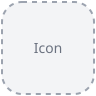

<div>
  <h1>SwiftSymbols </h1>
  <p>Browse and select SF Symbols in a searchable, categorized SwiftUI grid.</p>
  <p>    </p>
</div>

## Installation

Add this directory as a local Swift package in Xcode and link **SwiftSymbols**. Link **SwiftSymbolsIndex** alone for Foundation-only catalog and search access.

## Quick start

```swift
import SwiftUI
import SwiftSymbols

struct SymbolPicker: View {
    @State private var index: SymbolIndex?
    @State private var selected: Symbol?
    @State private var query = ""
    @State private var errorMessage: String?

    var body: some View {
        NavigationStack {
            ScrollView {
                if let index {
                    SymbolGrid(symbols: index.search(query), selection: $selected)
                        .padding()
                } else if let errorMessage {
                    Text(errorMessage)
                } else {
                    ProgressView()
                }
            }
            .navigationTitle("Symbols")
            .searchable(text: $query)
            .task {
                do {
                    let catalog = try await Task.detached { try SymbolIndex.load() }.value
                    index = catalog.availableOnCurrentSystem()
                } catch {
                    errorMessage = error.localizedDescription
                }
            }
        }
    }
}
```

Use `SymbolGrid(sections: index.sections, selection: $selected)` for categorized browsing. A `Symbol?` binding toggles single selection; a `Set<String>` binding toggles multiple symbol names. The callback initializer reports every tap, letting the host confirm a choice and dismiss. The host owns scrolling and navigation.

## Styling and search

Apply `.symbolGridStyle(.default(cellSize: 44, spacing: 4))`, `.large` or `.compact`. Implement `SymbolGridStyle` to customize grid layout, cells and headers.

Search matches all whitespace/dot-separated terms against names, keywords and category keys, ranking exact names first. `availableOnCurrentSystem()` filters names using public UIImage/NSImage lookup; apply it once before displaying the catalog. Symbols without a topical category appear in Other. Loading throws resource or decoding errors, which the host can present with a retry or dismissal action.

## Documentation

See the [DocC introduction](Sources/SwiftSymbols/SwiftSymbols.docc/SwiftSymbols.md) and [picker integration guide](Sources/SwiftSymbols/SwiftSymbols.docc/Integration/Integration.md).

## Catalog maintenance

The bundled name/category/search metadata comes from the installed Apple SF Symbols app. Regenerate it with `python3 Tools/build_catalog.py '/Applications/SF Symbols.app'`. Artwork is rendered by the operating system and remains subject to Apple's applicable SF Symbols use terms. Regenerate the catalog to include newly introduced names.

## Tests and license

Run `swift test` for catalog integrity and search coverage. SwiftSymbols is MIT licensed; its grid and style implementation is adapted from Aether's SwiftEmoji, with attribution retained in [LICENSE](LICENSE).
